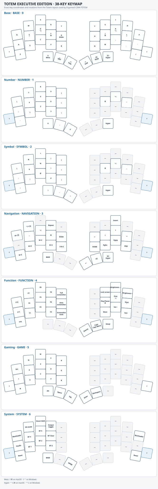

# Totem Executive Edition

38-key ZMK firmware for the [Ergomech Totem Executive Edition](https://ergomech.store/shop/totem-executive-edition-522), based on [Ergomech’s ZMK-TOTEM firmware](https://github.com/ergomechstore/ZMK-TOTEMIST).

## Central dongle firmware

On `central-dongle`, both halves connect to the KeebSupply XIAO nRF52840 dongle. Plug the dongle into the host for USB output and Studio access. The halves cannot connect directly to the host with this firmware. See [flashing and rollback instructions](docs/central-dongle.md).

<details>
<summary>Keymap</summary>



</details>

## Layers

| Layer | Use |
| --- | --- |
| **Base** | QWERTY with home-row modifiers. Thumb holds access Navigation, Function, Symbol, and Number. |
| **Number** | Number pad, brackets, and number-row symbols. |
| **Symbol** | Punctuation and shifted symbols. |
| **Navigation** | Cursor and page movement, editing, and clipboard shortcuts. |
| **Function** | F-keys, media, brightness, search, emoji, screenshots, and screen lock shortcuts. |
| **Gaming** | Shifted left-hand gaming keys with plain thumb keys. |
| **System** | OS mode, Smart Shift, output, Bluetooth profiles, Studio, bootloader, and settings reset. |

Hold Space + Enter to toggle Navigation, or Tab + Enter to toggle System from Base or Gaming. On System, press the Tab thumb to enter Gaming. Combos use physical key positions. On Navigation and System, the Escape thumb returns to Base.

## Key behaviors

- **OS mode** switches the active Bluetooth profile between macOS and Windows conventions. Each of the five profiles remembers its mode. In Windows mode, Control and GUI/Command swap; OS-specific shortcut keys send the matching shortcut for that system.
- **Smart Shift** toggles automatic sentence capitalization. **Caps Logic** toggles Caps Word on tap and sends Caps Lock on hold.
- **Meta** and **Hyper** are multi-modifier shortcuts. Their macOS and Windows modifier combinations are shown below the keymap.
- **Output toggle** switches between USB and Bluetooth. Bluetooth controls select profiles 0–4 or clear their pairings.

## macOS layer indicator

The central publishes the active layer over a vendor-defined USB HID interface and a Bluetooth characteristic. Install [Hammerspoon](https://www.hammerspoon.org/) and build the companion reader on the Mac:

```sh
sh tools/build-totem-layer-app.sh "$HOME/Applications/Totem Layer Reader.app"
open "$HOME/Applications/Totem Layer Reader.app"
```

Grant Bluetooth access if prompted. Connect the Totem to macOS by USB or pair it in Bluetooth settings. The reader prefers USB when both links are available. To launch the reader at login, add it to Login Items.

Copy [totem-layer.lua](tools/totem-layer.lua) to `~/.hammerspoon/totem-layer.lua` and add this line to `~/.hammerspoon/init.lua`:

```lua
totemLayerIndicator = require("totem-layer")
```

Reload Hammerspoon. The menu shows the current layer after the reader connects. If macOS has cached the older Bluetooth services and the layer stays blank, forget and pair the Totem again.
